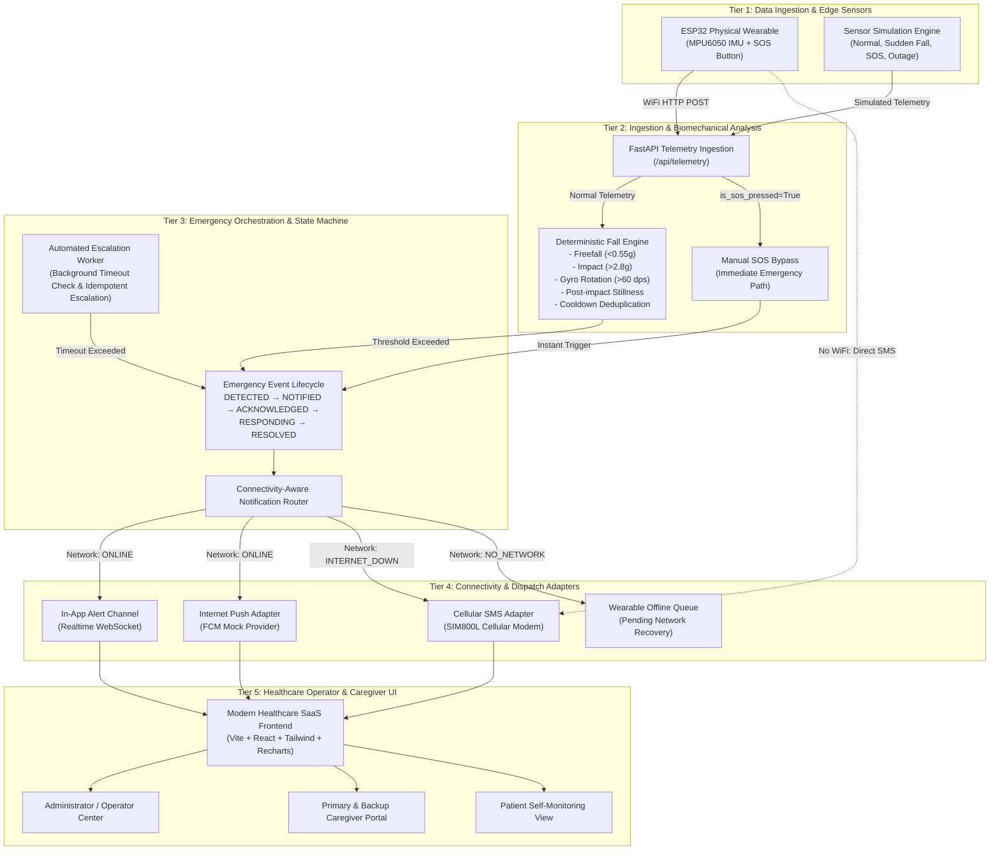

# LifeLink AI — Architecture & System Design

LifeLink AI is a connectivity-aware emergency response and remote health monitoring system architected to guarantee rapid alert dissemination even under degraded network conditions.

---

## 1. High-Level Architecture Diagram

---

## 2. Core Architectural Pillars

1. **Biomechanical Sliding Window Detection**:
   Rather than triggering false alarms on transient vibrations, the detection engine analyzes acceleration windows to verify the complete biomechanical trajectory of a fall (weightlessness phase, impact peak, orientation change, followed by stillness).

2. **Deduplication Cooldown**:
   A patient-level cooldown buffer prevents multiple alarms from flooding caregivers if repeated sensor spikes arrive during a single incident.

3. **Deterministic Manual SOS Bypass**:
   Human intent takes absolute priority. Pressing the physical or simulated SOS button immediately enters the emergency state machine, completely bypassing the heuristic fall classifier.

4. **Connectivity-Aware Routing Matrix**:
   - **ONLINE**: Dispatches high-speed internet push and updates in-app dashboard.
   - **INTERNET_DOWN**: Detects WiFi drop and automatically routes emergency dispatch to cellular SMS modem.
   - **NO_NETWORK**: Stores the alert in local wearable buffer, warning operators in the UI until network recovery flushes the queue.

5. **Automated Escalation Worker**:
   A persistent background supervisor tracks unacknowledged critical emergencies. If the primary caregiver does not acknowledge within the configured timeout (e.g., 60 seconds), the system idempotently triggers notifications to the assigned backup caregiver and marks the event as `ESCALATED`.
