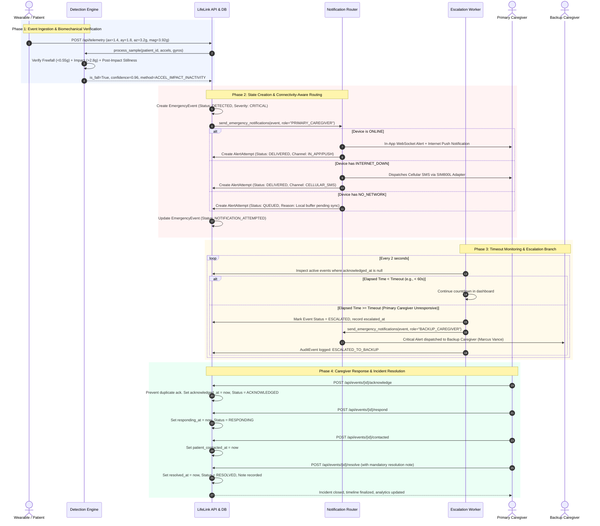

# LifeLink AI — Emergency Response & Escalation Sequence

The following sequence diagram details the complete end-to-end lifecycle of an emergency event from sensor spike to caregiver acknowledgement, timeout escalation, and incident resolution.

---

